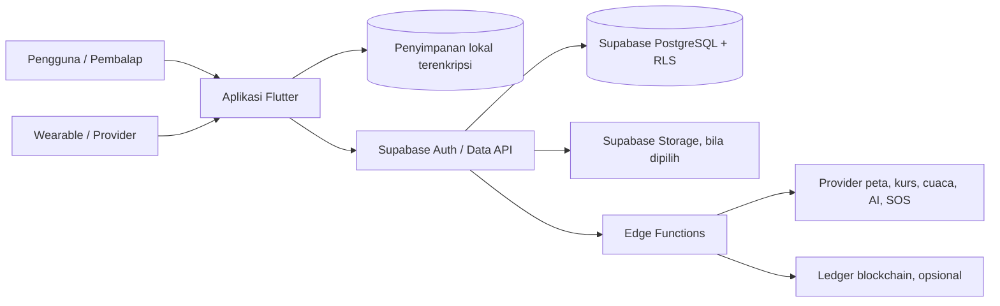

# Arsitektur Aplikasi Senapath

## 1. Tujuan dan Status

Dokumen ini menjelaskan arsitektur target yang direkomendasikan untuk Senapath, aplikasi Flutter pendamping latihan dan balapan sepeda. Dokumen ini melengkapi [requirements.md](requirements.md) dan [scrum-guide.md](scrum-guide.md).

Status saat ini: repository memiliki alur lokal Sprint 2-3. **Drift di atas SQLite dipilih sebagai database lokal/offline; Supabase dipilih sebagai platform database cloud.** Project Supabase sudah dibuat menurut pemilik produk, tetapi URL/key, schema, RLS, Auth, dan sync client belum dikonfigurasi. Provider lain dan perangkat sasaran masih perlu diriset. Tidak ada cloud sync yang boleh ditampilkan aktif sebelum konfigurasi dan kebijakan akses diuji.

## 2. Prinsip Arsitektur

- **Feature-first dan Clean Architecture:** kode dikelompokkan berdasarkan kapabilitas produk; UI bergantung pada domain, sedangkan domain tidak bergantung pada Flutter atau provider eksternal.
- **Offline-first untuk alur penting:** sesi, telemetri, hasil game, kontak, dan rute yang diunduh tetap tersedia lokal; jaringan memperkaya dan menyinkronkan data, bukan menjadi syarat untuk mulai merekam.
- **Sumber dan kualitas data eksplisit:** setiap metrik memiliki unit kanonis, timestamp, sumber, serta status kualitas/estimasi bila relevan.
- **Keamanan dan privasi sejak awal:** izin dan persetujuan mendahului akses/pengiriman; rahasia provider tidak ditanam di aplikasi; data lokasi/kontak tidak masuk log umum.
- **Integrasi dapat diganti:** provider peta, kurs, AI, wearable, SOS dan ledger diisolasi di lapisan data/integrasi agar pilihan vendor tidak menyebar ke domain.
- **Keselamatan mengalahkan kelengkapan metrik:** aplikasi tidak menyatakan estimasi sensor sebagai pengukuran tervalidasi dan tidak menyatakan pengiriman SOS berhasil sebelum ada konfirmasi.

## 3. Gambaran Sistem



Diagram ini adalah batas tanggung jawab konseptual. Supabase dipilih untuk cloud database; kapabilitas Supabase lain dan provider eksternal belum semuanya diputuskan. Kunci rahasia provider berada di Edge Functions/secret manager, bukan di aplikasi.

## 4. Arsitektur Aplikasi Flutter

### Lapisan

- **Presentation:** halaman, widget, navigasi `go_router`, dan state BLoC/Cubit. Lapisan ini mengubah input pengguna menjadi pemanggilan use case dan menampilkan state yang bermakna: loading, empty, offline, pending, success, atau error.
- **Domain:** entity, value object, aturan bisnis, interface repository, serta use case. Contoh: `StartRideSession`, `PauseRideSession`, `SyncPendingSessions`, `ConvertEventTime`, dan `ConnectWearable`. Lapisan ini tidak mengimpor package Flutter, Drift, Dio, atau SDK vendor.
- **Data:** implementasi repository, model DTO, mapper, local/remote data source, dan adapter provider. Repository memilih sumber lokal/jaringan sesuai aturan offline-first dan mengubah kegagalan teknis menjadi hasil domain yang terkontrol.
- **Platform/integration:** adapter permission, lokasi, sensor, secure storage, background execution, peta, wearable, notifikasi, dan integrasi native khusus platform.

### Struktur folder usulan

```text
lib/
  app/
    app.dart
    router/
    di/
    theme/
  core/
    errors/
    network/
    storage/
    permissions/
    sync/
    telemetry/
    units/
  features/
    authentication/
      data/ domain/ presentation/
    ride_session/
      data/ domain/ presentation/
    routes/
      data/ domain/ presentation/
    emergency/
    wearable/
    profile/
    converters/
    reaction_game/
    settings/
```

Nama dan jumlah feature dapat berubah saat kebutuhan dipecah. Hindari membuat satu folder global besar untuk seluruh model, repository, dan BLoC; tempatkan implementasi dekat dengan feature pemiliknya. `core` hanya untuk kemampuan lintas feature yang benar-benar dipakai bersama.

### State management dan dependency injection

- Gunakan `flutter_bloc` untuk state UI dan alur yang punya transisi jelas. BLoC memanggil use case, bukan mengakses Drift, Dio, atau plugin secara langsung.
- Gunakan `get_it` dengan `injectable` untuk mendaftarkan dependency. Jaga pembuatan dependency pada composition root, bukan di dalam widget atau use case.
- Gunakan `go_router` untuk routing dan redirect yang bergantung pada status autentikasi. Redirect tidak menggantikan otorisasi backend.
- Pisahkan state domain yang persisten dari state tampilan sementara. Contoh: status sesi aktif berasal dari repository/domain; animasi tombol tetap state UI lokal.

## 5. Penyimpanan Lokal dan Model Data

### Keputusan database lokal: Drift

Senapath menggunakan **Drift di atas SQLite** untuk sesi, telemetri, status sinkronisasi, dan data lokal terstruktur. Pilihan ini sesuai untuk transaksi, query berdasarkan sesi/waktu, dan migrasi schema. Drift telah diputuskan, tetapi dependency belum dipasang dan implementasi schema, strategi migrasi, serta enkripsi database masih perlu dirinci dan diuji.

Hindari menambahkan Hive sebagai penyimpanan kedua tanpa kebutuhan terpisah yang jelas. Jika kelak cache key-value memerlukannya, dokumentasikan batas kepemilikan data agar tidak ada dua sumber kebenaran untuk entitas yang sama. Validasi Drift dengan volume telemetri dan perangkat sasaran.

### Entitas domain minimum

- `RideSession`: ID stabil, waktu mulai/selesai, status sesi, status sinkronisasi, ringkasan, dan metadata versi.
- `TelemetrySample`: session ID, timestamp, lokasi/metric yang tersedia, unit kanonis, sumber (GPS ponsel, barometer, wearable/provider), serta kualitas/flag estimasi.
- `EmergencyContact`: data kontak yang diperlukan saja dan status sinkronisasi; data terlindungi saat tersimpan.
- `Route`: geometri, POI, metadata sumber/waktu, serta status ketersediaan offline.
- `ExternalConnection`: provider, identitas koneksi non-rahasia, cakupan izin, waktu sinkron terakhir, dan status pencabutan.
- `SyncOperation`: jenis/ID entitas, idempotency key, status, jumlah percobaan, waktu percobaan berikutnya, dan error yang aman ditampilkan.

Gunakan unit kanonis pada domain (misalnya meter, meter per second, timestamp UTC) dan konversi hanya saat presentasi/ekspor. Kunci idempotensi dan ID aktivitas provider perlu stabil supaya retry tidak membuat duplikasi.

## 6. Alur Perekaman dan Sinkronisasi

1. Aplikasi memeriksa izin dan ketersediaan sumber melalui `geolocator`, `sensors_plus`, serta pemeriksaan wearable bila terhubung.
2. Use case membuat sesi lokal dengan ID stabil. Status transisi sesi dibatasi, misalnya `ready -> recording -> paused -> recording -> completed`.
3. Service/platform adapter mengumpulkan event lokasi dan sensor; normalisasi unit/timestamp dilakukan sebelum data dikirim ke repository.
4. Repository menyimpan sampel secara berkala/batch ke penyimpanan lokal. Kegagalan jaringan tidak menghentikan perekaman lokal. Atur frekuensi batch dan retensi berdasarkan uji kehilangan data, performa, storage, dan baterai.
5. Sync worker mengirim sesi/operasi tertunda saat koneksi tersedia. Backend menerima idempotency key; client mempertahankan data pending sampai menerima konfirmasi.
6. UI menampilkan status lokal, menunggu, tersinkron, atau gagal. Retry menggunakan backoff yang dibatasi dan tidak mengubah status menjadi sukses tanpa respons konfirmasi.

Pisahkan **perekaman sensor** dari **pengiriman jaringan**. Jangan menjalankan request REST pada callback sensor yang harus tetap ringan. Tangani timestamp tidak monoton, sampel terlambat, pause/resume, aplikasi dihentikan, dan perubahan izin.

## 7. Backend dan Kontrak API

Supabase dipilih sebagai platform cloud Senapath: PostgreSQL menjadi penyimpanan cloud dan Supabase Data API menyediakan akses terautentikasi. Aplikasi tetap membaca/menulis data inti ke Drift terlebih dahulu; outbox lokal menyimpan perubahan yang belum tersinkron sampai koneksi dan konfigurasi tersedia. Supabase Auth, Storage, dan Edge Functions adalah kapabilitas yang akan dievaluasi/dikonfigurasi sesuai kebutuhan; pemilihan database cloud tidak otomatis berarti semua fitur tersebut sudah aktif.

API/backend minimal perlu mendefinisikan:

- model autentikasi Supabase (jika dipilih), refresh/revocation token, otorisasi per pengguna, dan versi kontrak data;
- operasi upsert idempotent untuk sesi, titik/summary, kontak, dan hasil game;
- sinkronisasi delta dengan cursor atau mekanisme setara, konflik data, retry, dan konfirmasi penerimaan;
- operasi/status terpisah untuk SOS, wearable connection/callback, feedback, dan publikasi proof; operasi yang memerlukan secret/provider privilege dijalankan melalui Edge Functions;
- validasi payload, rate limit, batas ukuran, retensi, backup, audit akses sensitif, serta kebijakan penghapusan akun/data.

Sebelum client Supabase diaktifkan, buat schema/migrasi SQL, ownership kolom `user_id`, dan **Row Level Security (RLS)** untuk semua tabel yang dapat diakses client. Uji bahwa pengguna hanya dapat membaca/mengubah baris miliknya. Anon/publishable key memang nilai client, tetapi aman hanya dengan RLS yang benar; `service_role` key tidak boleh masuk Flutter, git, build artifact, atau log. Simpan konfigurasi lokal di file yang di-ignore atau `--dart-define-from-file`, dan gunakan secret/config CI untuk build. Jangan commit credential proyek.

Saat cloud dikonfigurasi, tambahkan `supabase_flutter` dan buat adapter remote/sync worker. Sampai saat itu, operasi profil/kontak tetap local-only dengan status tertunda; jangan membuat request ke URL contoh atau menganggap secure local storage sebagai database cloud.

`Dio` hanya menangani komunikasi HTTP di client: base configuration, timeout, serialisasi, error mapping, dan interceptor. Interceptor boleh menambahkan token dan metadata korelasi, tetapi tidak boleh mencatat token, koordinat rinci, data kontak, atau isi SOS. Rahasia provider dan panggilan yang membutuhkan server-side key ditangani backend.

## 8. Peta, Wearable, AI, SOS, dan Blockchain

- **Peta:** pilih satu integrasi utama, `flutter_map` atau `google_maps_flutter`, setelah membandingkan provider tile, lisensi, biaya, geocoding, elevasi, cache, dan offline. Tile offline tidak otomatis diizinkan oleh semua provider. Isolasi melalui `MapRepository`/adapter.
- **Wearable:** mulai dengan satu provider/perangkat yang aksesnya disetujui. OAuth/token provider dikelola dengan aman; data yang diimpor memiliki sumber, timestamp, unit, dan izin. Tetapkan apakah wearable mengimpor aktivitas setelah latihan atau menyediakan data sesi live; keduanya kebutuhan teknis berbeda.
- **AI:** client memanggil endpoint backend Senapath; backend menghubungi Gemini/OpenAI atau provider terpilih. Terapkan persetujuan, minimisasi data, timeout, batas biaya, retensi, dan fallback. Jangan letakkan API key LLM pada bundle Flutter.
- **SOS:** countdown/pembatalan dan alarm lokal berjalan di perangkat; pengiriman remote menggunakan API/backend serta kanal yang dipilih. Persist status `queued/sending/sent/failed`; jangan menyatakan berhasil sebelum konfirmasi. Jalur cancel harus menghentikan pengiriman selama pesan belum dikirim.
- **Blockchain:** hash dihitung dari representasi sesi yang kanonis dan berversi; kirim hanya data yang disetujui. `web3dart`/RPC adalah klien protokol, bukan solusi untuk custody key, transaksi, biaya, atau keamanan. Putuskan wallet pengguna versus server/relayer sebelum implementasi dan jangan publikasikan data pribadi/rute.
- **Kurs/cuaca/notifikasi:** panggilan yang memerlukan API key sebaiknya diproksikan backend. Cache menyimpan timestamp/sumber dan UI membedakan data stale dari real-time. Notifikasi lokal dan push remote diperlakukan sebagai kanal berbeda.

## 9. Keamanan, Privasi, dan Izin

- `flutter_secure_storage` menyimpan token dan kunci pembuka data terenkripsi; tentukan backup/restore, rotasi, logout, perangkat rooted/jailbroken sesuai threat model, serta apa yang terjadi bila kunci hilang.
- Biometrik melalui `local_auth` adalah gate lokal untuk penggunaan kredensial yang dilindungi platform; biometrik bukan pengganti autentikasi/otorisasi server.
- Minta izin tepat sebelum fitur membutuhkan lokasi, notifikasi, foto, atau koneksi sensor/provider. Berikan alasan, dampak penolakan, dan cara mencabut akses.
- Pisahkan data identitas dari telemetri bila memungkinkan. Terapkan prinsip minimisasi: kumpulkan hanya sampel dan metrik yang diperlukan, batasi retensi, dan hapus sesuai pilihan/kebijakan.
- Jangan menulis token, koordinat detail, kontak, payload wearable privat, atau isi SOS ke log, analytics, crash report, maupun blockchain publik.
- Pindahkan secret ke backend/secret manager; validasi TLS dan konfigurasi environment; audit dependency dan permission sebelum rilis.

## 10. Background, Sensor, dan Batas Platform

`flutter_background_service` dapat menjadi bagian implementasi, tetapi bukan jaminan bahwa proses selalu berjalan. Desain harus memperhitungkan lifecycle dan kebijakan OS, service/notification foreground Android bila diwajibkan, batas background iOS, izin lokasi, penghentian proses, optimasi baterai, dan perpindahan antar-isolate. Persist state sesi sebelum mengandalkan proses jangka panjang; saat aplikasi kembali dibuka, rekonstruksi status dari penyimpanan lokal.

GPS tetap sumber utama lokasi/pergerakan sesuai requirement. `sensors_plus` menyediakan event sensor, bukan algoritme tervalidasi untuk cadence, lean angle, atau deteksi insiden. Semua estimasi perlu validasi perangkat/kondisi, label kualitas, dan fallback aman. Pemisahan `LocationSource`, `MotionSensorSource`, dan `WearableSource` memudahkan pengujian dengan fake source.

## 11. Jaringan dan Penanganan Error

- Bungkus Dio di remote data source; domain menerima error/result yang stabil, bukan exception Dio.
- Klasifikasikan error: koneksi, timeout, autentikasi, validasi, rate limit, provider unavailable, dan konflik.
- Retry hanya untuk operasi yang aman/idempotent; gunakan backoff dan batas percobaan. Jangan retry agresif SOS, transaksi blockchain, atau operasi berbiaya tanpa kebijakan yang eksplisit.
- Cache online data dengan timestamp dan sumber; semua UI membedakan data terbaru, stale, unavailable, dan data lokal.
- Sinkronisasi tidak boleh menghalangi pembacaan ringkasan/rute lokal atau membuat fitur lokal bergantung pada status provider.

## 12. Pengujian dan Observability

- **Unit:** use case, aturan transisi sesi, konversi unit/waktu, deduplikasi, penghitungan metrik dan error mapping.
- **Data/integrasi:** repository dengan fake local/remote sources; migrasi database; retry/idempotensi; serialisasi dan kontrak API.
- **Widget:** loading, kosong, offline, izin ditolak, pending/gagal, status kualitas metrik dan aksesibilitas kontrol sesi.
- **Perangkat/end-to-end:** background/layar mati, kehilangan jaringan, restart aplikasi saat sesi aktif, GPS lemah, sensor tak tersedia, wearable dicabut, serta SOS dibatalkan.
- **Observability:** crash/performa dan error provider dengan redaksi data sensitif; gunakan correlation ID untuk sync tanpa memasukkan koordinat atau token.
- **Release gates:** analisis statis, test suite, dependency/security review, build platform target, dan uji manual alur kritis.

## 13. Kandidat Paket dan Keputusan Terbuka

| Area            | Kandidat                                                             | Keputusan yang perlu dibuat                                                                                |
| --------------- | -------------------------------------------------------------------- | ---------------------------------------------------------------------------------------------------------- |
| Framework       | Flutter/Dart                                                         | Sudah menjadi basis repository.                                                                            |
| Arsitektur      | Clean Architecture, feature-first                                    | Tetapkan dependency rule dan batas module/feature.                                                         |
| State           | `flutter_bloc`                                                       | Gunakan BLoC/Cubit secara konsisten; pilih strategi error/state bersama.                                   |
| Database lokal  | Drift di atas SQLite                                                 | Sudah dipilih. Riset/implementasikan schema, migrasi, enkripsi, dan uji volume; hindari sumber data ganda. |
| Secret lokal    | `flutter_secure_storage`                                             | Tentukan platform, key lifecycle, backup, rotasi, dan pemulihan.                                           |
| HTTP            | Dio + interceptor                                                    | Tetapkan kontrak API, auth refresh, redaksi log, timeout dan retry.                                        |
| DI              | `get_it` + `injectable`                                              | Satu composition root dan aturan scope/lifecycle.                                                          |
| Routing         | `go_router`                                                          | Tentukan route auth, deep link, dan navigasi utama.                                                        |
| Lokasi/sensor   | `geolocator`, `sensors_plus`                                         | Validasi izin, akurasi, background, baterai, serta perangkat sasaran.                                      |
| Biometrik       | `local_auth`                                                         | Tetapkan fallback aman; jangan perlakukan sebagai server authentication.                                   |
| Background      | `flutter_background_service` atau mekanisme platform sesuai use case | Uji Android/iOS; tetapkan batas layanan dan perilaku setelah process kill.                                 |
| Peta            | `flutter_map` atau `google_maps_flutter`                             | Pilih satu setelah lisensi, biaya, provider, dan offline dievaluasi.                                       |
| Wearable        | Provider API/SDK terpilih                                            | Pastikan akses dan izin provider; tentukan import historis versus live.                                    |
| AI              | Backend REST ke provider LLM                                         | Jangan panggil provider ber-secret langsung dari aplikasi.                                                 |
| Blockchain      | Backend/relayer atau wallet pengguna; RPC client                     | Putuskan custody key, biaya, jaringan, canonical hash, consent, dan retry.                                 |
| Cloud database  | Supabase dipilih                                                     | Konfigurasikan URL/key, schema/migrasi SQL, RLS, backup, dan strategi Drift outbox sebelum sync client.    |
| Supabase Auth   | Belum diputuskan                                                     | Tentukan metode login/account-linking dan bagaimana token cloud berinteraksi dengan local device unlock.   |
| Cloud storage   | Belum diputuskan                                                     | Tentukan apakah foto/media perlu Supabase Storage, bucket private, policy, dan signed URL.                 |
| Edge Functions  | Belum diputuskan                                                     | Evaluasi untuk operasi SOS/provider yang memerlukan secret; jangan simpan service-role key di client.      |
| Push/notifikasi | Lokal dan provider push terpilih                                     | Tentukan platform, consent, payload minimal, dan status delivery.                                          |
| Pengujian/CI    | Flutter test, analyzer, pipeline CI                                  | Tentukan provider CI, build signing, device matrix, dan quality gates.                                     |

## 14. Tahapan Implementasi yang Disarankan

1. **Fondasi:** konfigurasi Supabase tanpa mengekspos secret, tentukan schema/RLS, detail implementasi Drift (schema, migrasi, enkripsi), model sesi, dependency direction, logging redacted, CI, dan perangkat sasaran.
2. **Core offline:** implementasikan autentikasi lokal, izin/kesiapan, sesi, penyimpanan telemetri, pemulihan setelah restart, ringkasan, dan formatter unit.
3. **Keandalan:** tambahkan outbox/idempotensi, sinkronisasi, status dan retry; uji offline, storage, background, dan konflik.
4. **Integrasi perangkat dan peta:** pilih satu provider wearable dan peta; validasi dukungan, sumber metrik, lisensi, izin, dan mode offline.
5. **Layanan tambahan:** kurs, cuaca, AI, SOS remote, feedback, blockchain, dan leaderboard setelah provider, risiko privasi, biaya, serta alur consent disetujui.
6. **Release hardening:** uji perangkat nyata, aksesibilitas, baterai, keamanan, pemulihan data, dan skenario jaringan/izin yang gagal.

Setiap tahap tetap dikerjakan sebagai Increment Scrum; urutan ini bukan fase waterfall dan dapat disesuaikan melalui Product Backlog.

## 15. Catatan Keputusan Arsitektur yang Perlu Dicatat

Simpan keputusan besar sebagai ADR singkat dengan konteks, opsi, keputusan, konsekuensi, pemilik, dan tanggal. ADR awal yang disarankan:

- implementasi Drift untuk telemetri: schema, migrasi, enkripsi, strategi backup/pemulihan, dan kebutuhan cache terpisah;
- Supabase Auth atau model autentikasi lain, kontrak data, sinkronisasi, dan konflik;
- provider peta, kurs, cuaca, wearable, AI, SOS, dan push;
- target platform/perangkat serta kebijakan perekaman background;
- pengelolaan kunci lokal, retensi data, consent, serta penghapusan akun;
- metode signing/pengiriman transaksi blockchain dan aturan publikasi leaderboard.

## 16. Keputusan dan Baseline Privasi Sprint 1

### Keputusan awal

| Area                    | Status Sprint 1  | Keputusan atau tindak lanjut                                                                                                     | Pemilik tindak lanjut |
| ----------------------- | ---------------- | -------------------------------------------------------------------------------------------------------------------------------- | --------------------- |
| Framework               | Dipakai          | Flutter dan Dart, sesuai scaffold repository.                                                                                    | Developers            |
| Struktur kode           | Dipilih          | Feature-first dengan batas Presentation, Domain, Data, dan Platform/Integration. Domain tidak mengimpor framework atau provider. | Developers            |
| Navigasi                | Dipakai          | `go_router` untuk empat destinasi shell awal. Dependency sudah ditambahkan; halaman fitur masih berupa empty state yang jujur.   | Developers            |
| Database lokal          | Dipilih          | Drift di atas SQLite. Dependency/schema/migrasi/enkripsi belum diimplementasikan; dirinci pada pekerjaan berikutnya.             | Developers            |
| State management        | Direncanakan     | `flutter_bloc` untuk alur stateful berikutnya; shell statis belum membutuhkan BLoC.                                              | Developers            |
| DI                      | Belum diperlukan | `get_it`/`injectable` dipasang saat dependency/use case aplikasi bertambah dan composition root dibutuhkan.                      | Developers            |
| Backend dan autentikasi | Riset terbuka    | Pilih backend, model akun/token, kontrak API, sinkronisasi, serta operasi/retensi data. Belum ada integrasi produksi.            | PO dan technical lead |
| Provider eksternal      | Riset terbuka    | Bandingkan provider peta, kurs, wearable, AI, SOS, push, dan ledger beserta akses, izin, biaya, dan lisensinya.                  | PO dan technical lead |
| Perangkat sasaran       | Riset terbuka    | Tetapkan versi OS/perangkat minimum untuk validasi izin, sensor, background, baterai, dan UI.                                    | PO dan Developers     |

Daftar ini mencatat keputusan dan status saat Sprint 1; pilihan riset terbuka bukan komitmen menggunakan provider tertentu. Dokumentasikan keputusan baru sebagai ADR saat opsi dan konsekuensinya sudah ditinjau.

### Aliran data dan larangan logging

| Kategori               | Status pada shell Sprint 1                    | Aturan sebelum fitur terkait dibuat                                                                                                                                                      |
| ---------------------- | --------------------------------------------- | ---------------------------------------------------------------------------------------------------------------------------------------------------------------------------------------- |
| Lokasi dan sensor      | Belum diminta atau dikumpulkan oleh shell.    | Minta izin saat dibutuhkan, simpan lokal melalui repository, dan sinkronkan hanya sesuai persetujuan/kebijakan yang dijelaskan kepada pengguna. Jangan log koordinat atau sampel mentah. |
| Kontak darurat dan SOS | Belum diminta, disimpan, atau dikirim.        | Lindungi data kontak lokal; kirim hanya lewat kanal yang diputuskan dan setelah pengguna mengatur/menyetujui alurnya. Jangan log kontak, isi pesan, atau payload lokasi.                 |
| Kredensial dan token   | Belum ada autentikasi atau token di aplikasi. | Gunakan secure storage dan redaksi header/payload; jangan mencatat kredensial atau token.                                                                                                |
| Wearable               | Belum terhubung.                              | Minta izin provider, simpan token secara aman, batasi metrik yang diambil, dan tampilkan sumber/status; rahasia tidak masuk log.                                                         |
| Diagnostik             | Belum ada logger/analytics pihak ketiga.      | Error hanya mencatat konteks teknis minimum dengan data pribadi disunting; jangan menambahkan `print`/`debugPrint` untuk payload sensitif.                                               |

Shell Sprint 1 tidak melakukan request jaringan dan tidak mengumpulkan data pengguna. CI hanya menjalankan build-quality checks dan tidak membutuhkan secret. Kebijakan ini menjadi baseline, bukan pengganti threat model atau persetujuan provider.

## 17. Status Implementasi Lokal dan Kontrak Cloud

| Area               | Status implementasi                                                                                                                                                                                                                             | Batasan saat ini                                                                                                                                                                                                                                                                 |
| ------------------ | ----------------------------------------------------------------------------------------------------------------------------------------------------------------------------------------------------------------------------------------------- | -------------------------------------------------------------------------------------------------------------------------------------------------------------------------------------------------------------------------------------------------------------------------------- |
| Local unlock       | Biometrik dan kredensial kunci layar OS melalui `local_auth`; logout mengunci ulang aplikasi.                                                                                                                                                   | Ini adalah device unlock, bukan autentikasi akun Supabase. Tidak ada cloud session/token.                                                                                                                                                                                        |
| Profil dan kontak  | Disimpan melalui platform secure storage; avatar dienkripsi AES-GCM di app-private storage.                                                                                                                                                     | Data hanya tersimpan di perangkat dan belum tersinkron. Logout tidak menghapus profil/riwayat.                                                                                                                                                                                   |
| Preferensi unit    | Disimpan lokal di Drift/SQLite.                                                                                                                                                                                                                 | Preferensi belum disinkron ke Supabase.                                                                                                                                                                                                                                          |
| Sesi dan telemetri | Lifecycle sesi, metrik agregat, history, serta status `pending` disimpan di Drift; payload lokasi/barometer/motion dienkripsi AES-GCM dengan key di secure storage. Ringkasan menghitung sumber elevasi dan grafik kecepatan dari sampel lokal. | GPS adalah sumber lokasi utama; barometer dipakai bila ada, GPS altitude berlabel estimasi bila kualitasnya cukup. Akselerometer/gyroscope tidak ditafsirkan sebagai cadence/lean angle. Streaming foreground saja; background recording dan cloud sync belum diimplementasikan. |
| Emergency/SOS      | `EmergencyCubit` mengelola countdown manual 15 detik, pembatalan, validasi kontak, serta adapter `url_launcher` untuk `tel:` dan WhatsApp.                                                                                                      | WhatsApp hanya dibuka dengan draft pesan dan tautan lokasi terakhir; aplikasi tidak dapat mengklaim pesan terkirim tanpa aksi/konfirmasi pengguna. Deteksi otomatis dan pengiriman remote belum aktif.                                                                           |
| Rute dan POI       | Metadata rute tersimpan di Drift dan dapat dicari offline melalui repository/Cubit; sumber, elevasi, POI, dan availability ditampilkan saat ada.                                                                                                | Provider peta/tile, geocoding, geometry download, dan cache map belum dipilih; layar tidak mengklaim peta online/offline tersedia.                                                                                                                                               |
| Berkas dan storage | `SessionFileService` mengekspor JSON ber-versi dan GPX dari telemetri lokal; parser XML memvalidasi GPX; `OfflineStorageManager` memisahkan ukuran database dari directory `map_cache`.                                                         | Dialog file OS dapat dibatalkan/gagal; cache map belum berisi provider tile; penghapusan cache hanya boleh menyentuh directory cache, bukan Drift.                                                                                                                               |
| Logistik           | Anggaran multi-item, kurs EUR manual, dan preferensi mata uang tujuan disimpan lokal di `AppPreferences`; waktu acara dihitung memakai database zona waktu IANA.                                                                                | Provider kurs otomatis belum dipilih; kurs manual menampilkan sumber dan waktu input serta tidak diklaim real-time. Jam DST yang hilang ditolak dan jam berulang meminta pilihan.                                                                                                |
| Cloud database     | Supabase PostgreSQL dipilih sebagai target remote.                                                                                                                                                                                              | URL/key, schema, RLS, backup, Auth, dan sinkronisasi belum dikonfigurasi; UI harus menyebut status pending/local.                                                                                                                                                                |
| Cloud data policy  | Target setiap baris milik akun melalui `user_id` dan RLS.                                                                                                                                                                                       | Jangan mengaktifkan akses client sebelum policy diuji dengan lebih dari satu identitas. `service_role` hanya server-side.                                                                                                                                                        |

**Sinkronisasi mendatang:** Drift tetap sumber lokal yang dapat dibaca saat offline. Perubahan cloud-bound dimasukkan ke outbox dengan ID/idempotency key stabil; baru ditandai tersinkron setelah Supabase mengonfirmasi. Konflik, retry, penghapusan, dan pemulihan akun harus dirancang sebelum sync diaktifkan. URL Supabase dan anon/publishable key dapat diberikan melalui konfigurasi environment lokal/CI setelah tersedia; service-role key tidak pernah dimasukkan ke aplikasi.
