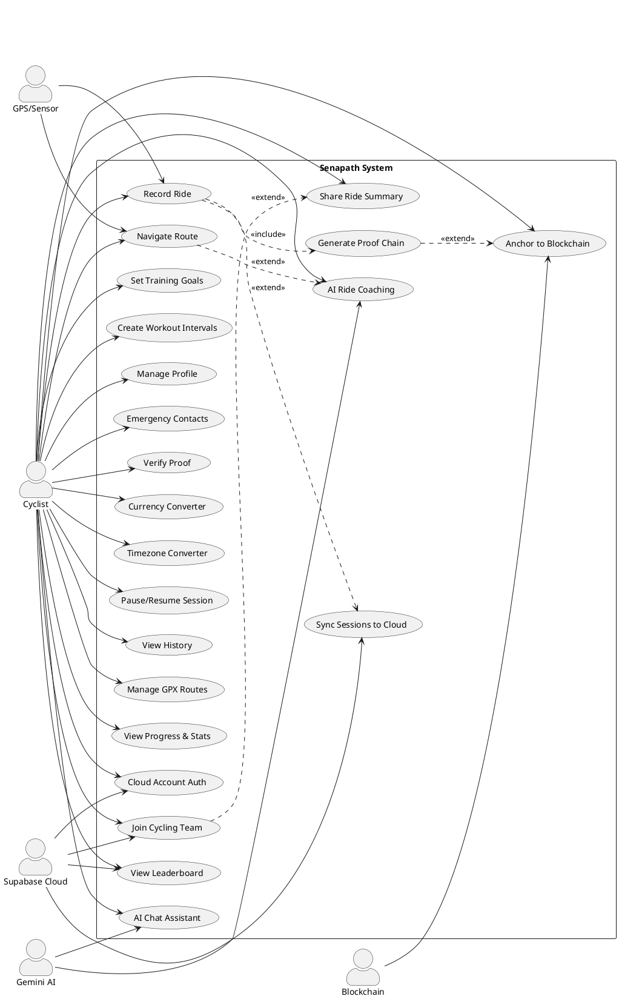
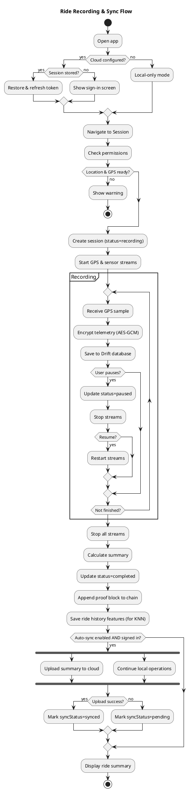
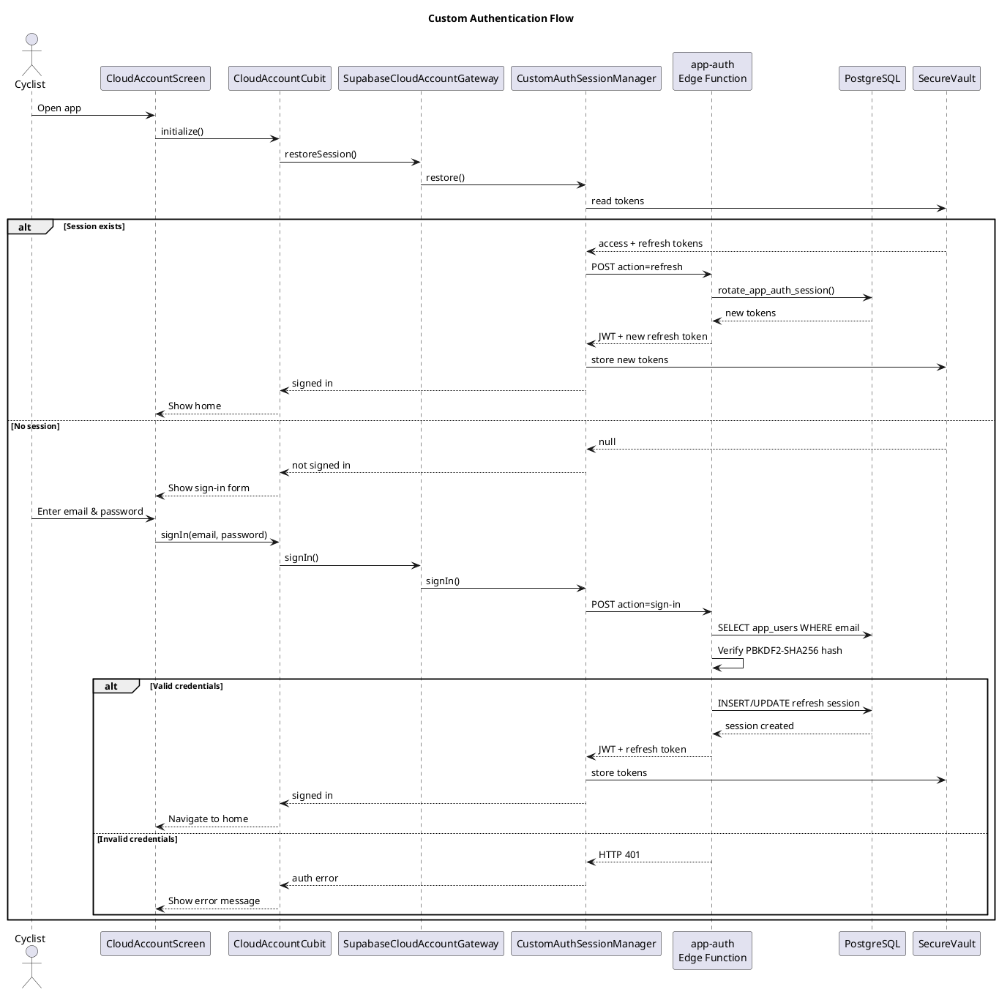
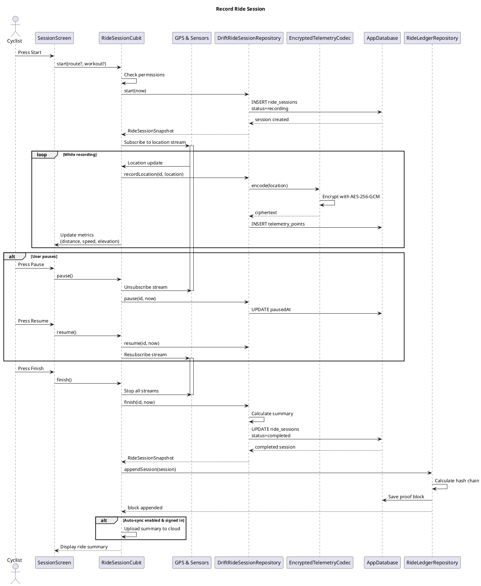
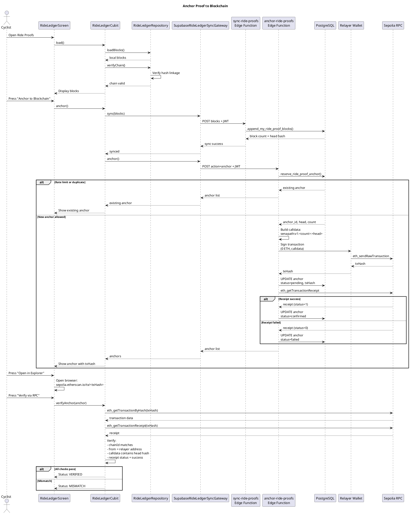
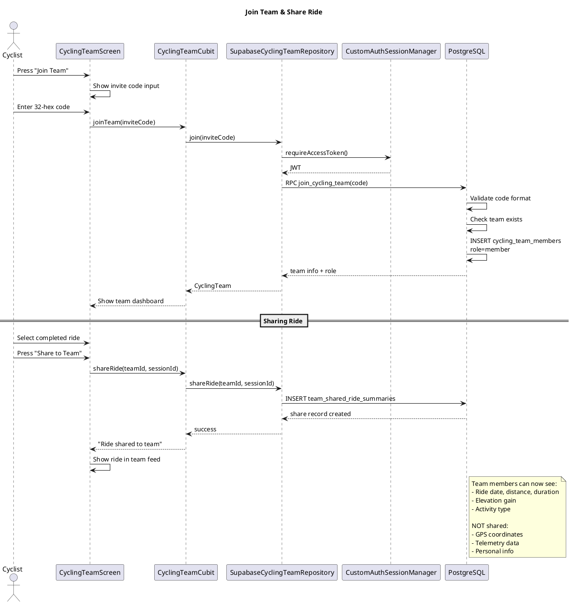
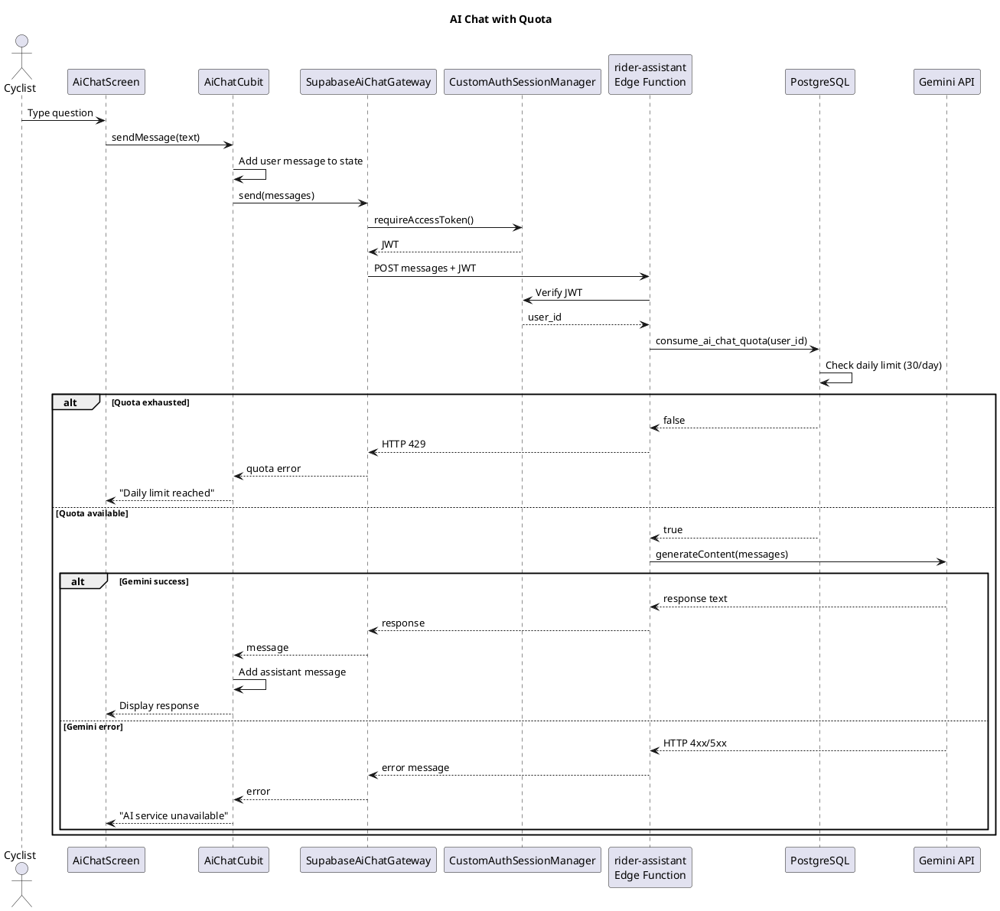

# Senapath - UML Diagrams

Dokumen ini berisi diagram UML yang menjelaskan arsitektur dan perilaku sistem Senapath secara ringkas namun lengkap. Diagram menggunakan PlantUML dan dapat dirender dengan ekstensi editor atau PlantUML Server.

**Daftar diagram:**
1. Use Case Diagram - aktor dan fitur utama
2. Use Case Scenarios - skenario pengguna utama
3. Activity Diagram - alur perekaman perjalanan
4. Class Diagram - struktur domain dan data
5. Sequence Diagram - interaksi komponen utama

---

## 1. Use Case Diagram



---

## 2. Use Case Scenarios

### Scenario 1: Recording a Ride Session
**Actor:** Cyclist  
**Precondition:** GPS and location permissions granted  
**Main Flow:**
1. Cyclist opens app and navigates to Session screen
2. System checks location permission and GPS availability
3. Cyclist optionally selects a GPX route to follow
4. Cyclist presses "Start Recording"
5. System creates session record in local database (Drift)
6. System starts GPS and sensor streams (location, barometer, accelerometer)
7. System records telemetry points (encrypted AES-256-GCM)
8. Cyclist can pause/resume during ride
9. Cyclist finishes ride
10. System stops streams, calculates summary (distance, duration, elevation)
11. System generates cryptographic proof block and appends to local chain
12. If auto-sync enabled and user signed in, system uploads summary to cloud
13. System displays ride summary

**Alternative Flow:**
- 4a. GPS not ready → System shows warning, cyclist can retry or proceed with limited tracking
- 8a. App backgrounded → System continues recording via foreground service (Android) or background location (iOS)
- 12a. No internet → Session remains local with "pending sync" status

**Postcondition:** Ride session saved locally, proof chain updated, optionally synced to cloud

---

### Scenario 2: Cloud Authentication & Sync
**Actor:** Cyclist  
**Precondition:** Supabase configured, internet available  
**Main Flow:**
1. Cyclist opens "Account & Security"
2. Cyclist enters email and password
3. System sends credentials to custom auth Edge Function `app-auth`
4. Edge Function verifies PBKDF2-SHA256 password hash
5. Edge Function generates JWT (HS256, aud=authenticated, sub=user_id)
6. Edge Function creates refresh token (rotated, hash stored in DB)
7. System stores tokens in secure storage (flutter_secure_storage)
8. System loads user profile and syncs pending sessions
9. Cyclist can enable biometric unlock for stored session

**Alternative Flow:**
- 4a. Invalid credentials → Error displayed, retry allowed
- 6a. Rate limit exceeded → Temporary lockout message
- 9a. User signs out → Tokens cleared, local data retained

**Postcondition:** User authenticated, sessions synced, biometric unlock available

---

### Scenario 3: Blockchain Proof Anchoring
**Actor:** Cyclist  
**Precondition:** Completed rides exist, user signed in, internet available  
**Main Flow:**
1. Cyclist opens "Ride Proofs"
2. System displays local proof chain blocks
3. System verifies chain integrity (hash linkage)
4. Cyclist presses "Anchor to Blockchain"
5. System syncs all blocks to Supabase
6. System calls Edge Function `anchor-ride-proofs`
7. Edge Function checks rate limit (10 min) and head hash uniqueness
8. Edge Function creates anchor record (status=pending)
9. Server-side relayer signs transaction with calldata `senapath:v1:<count>:<hash>`
10. Relayer sends 0 ETH transaction to Ethereum Sepolia via JSON-RPC
11. Edge Function waits for receipt
12. If success, updates anchor (status=confirmed, txHash, blockNumber)
13. Cyclist can view txHash on Sepolia explorer
14. Cyclist presses "Verify" to independently check via public RPC
15. System reads transaction and receipt, compares calldata and sender
16. System displays verification status (verified/pending/mismatch)

**Alternative Flow:**
- 7a. Rate limit hit or duplicate head → Returns existing anchor
- 10a. Transaction fails → status=failed, error logged
- 14a. Transaction not yet mined → status=pending

**Postcondition:** Proof head hash immutably recorded on blockchain, verifiable independently

---

### Scenario 4: Joining a Cycling Team
**Actor:** Cyclist  
**Precondition:** User signed in to cloud account  
**Main Flow:**
1. Cyclist navigates to "My Teams"
2. Cyclist presses "Join Team"
3. Cyclist enters 32-character hex invite code
4. System calls Supabase RPC `join_cycling_team`
5. RPC validates code format and checks team existence
6. RPC inserts member record with role=member
7. System displays team dashboard with members list
8. Cyclist can share completed ride summaries to team
9. Team members see shared rides (no GPS coordinates, only summary)

**Alternative Flow:**
- 5a. Invalid code → Error message
- 8a. Cyclist unshares or leaves team → Summary link removed from team view

**Postcondition:** Cyclist is team member, can share rides to team

---

### Scenario 5: AI Chat Assistant
**Actor:** Cyclist  
**Precondition:** User signed in, Gemini API configured, daily quota available  
**Main Flow:**
1. Cyclist opens "AI Assistant"
2. Cyclist types question about training or routes
3. System sends message to Edge Function `rider-assistant`
4. Edge Function verifies JWT and extracts user ID
5. Edge Function calls PostgreSQL function `consume_ai_chat_quota`
6. If quota available (30/day), Edge Function calls Gemini API
7. Gemini returns response
8. Edge Function returns answer to app
9. System displays answer in chat

**Alternative Flow:**
- 5a. Quota exhausted → HTTP 429, system shows "daily limit reached"
- 6a. Gemini error → System shows error message
- Context options: User can include local routes or preferences (with consent)

**Postcondition:** Cyclist receives AI-generated response, quota decremented

---

## 3. Activity Diagram



---

## 4. Class Diagram

```plantuml
@startuml
title Core Domain & Data Architecture

skinparam classAttributeIconSize 0
hide circle

package "Domain Models" {
  class RideSessionSnapshot {
    +id: String
    +title: String
    +activityType: ActivityType
    +startedAt: DateTime
    +endedAt: DateTime?
    +status: RideSessionStatus
    +syncStatus: String
    +distanceMeters: double
    +durationSeconds: int
  }
  
  class TelemetryLocation {
    +recordedAt: DateTime
    +latitude: double
    +longitude: double
    +accuracyMeters: double
    +altitudeMeters: double?
    +speedMetersPerSecond: double?
  }
  
  class RideLedgerBlock {
    +index: int
    +sessionId: String
    +createdAt: DateTime
    +distanceMeters: double
    +durationSeconds: int
    +previousHash: String
    +hash: String
  }
  
  class CyclingTeam {
    +id: String
    +name: String
    +inviteCode: String
    +createdAt: DateTime
  }
}

package "Repositories" {
  interface RideSessionRepository {
    +start(DateTime): RideSessionSnapshot
    +pause(id, DateTime)
    +resume(id, DateTime)
    +finish(id, DateTime)
    +recordLocation(id, TelemetryLocation)
    +loadCompletedSessions()
  }
  
  class DriftRideSessionRepository {
    -database: AppDatabase
    -codec: EncryptedTelemetryCodec
  }
  
  class RideLedgerRepository {
    -database: AppDatabase
    +loadBlocks(): List<RideLedgerBlock>
    +appendSession(session)
    +verifyChain(): bool
  }
  
  class CyclingTeamRepository {
    +joinTeam(inviteCode)
    +leaveTeam(teamId)
    +shareRide(teamId, sessionId)
    +unshareRide(shareId)
  }
}

package "Presentation" {
  class RideSessionCubit {
    +start(route?, workout?)
    +pause()
    +resume()
    +finish()
    +state: RideSessionState
  }
  
  class CloudAccountCubit {
    +signIn(email, password)
    +signUp(email, password)
    +signOut()
    +state: CloudAccountState
  }
  
  class RideLedgerCubit {
    +load()
    +sync()
    +anchor()
    +verifyAnchor(anchor)
    +state: RideLedgerState
  }
  
  class CyclingTeamCubit {
    +loadTeams()
    +joinTeam(code)
    +shareRide(teamId, sessionId)
    +state: CyclingTeamState
  }
}

package "Cloud Gateways" {
  interface CloudAccountGateway {
    +isConfigured: bool
    +isSignedIn: bool
    +signIn(email, password)
    +signUp(email, password)
  }
  
  class SupabaseCloudAccountGateway {
    -sessionManager: CustomAuthSessionManager
  }
  
  class CustomAuthSessionManager {
    +currentUserId: String?
    +requireAccessToken(): String
    +invokeAuthenticatedFunction(name, body)
  }
  
  interface RideLedgerSyncGateway {
    +sync(blocks)
    +anchor()
    +anchors()
  }
  
  class SupabaseRideLedgerSyncGateway
}

package "Storage" {
  class AppDatabase {
    +schemaVersion: int
    +rideSessions
    +telemetryPoints
    +savedRoutes
    +rideHistory
    +appPreferences
  }
  
  interface SecureVault {
    +read(key): String?
    +write(key, value)
    +delete(key)
  }
  
  class EncryptedTelemetryCodec {
    +encode(TelemetryLocation): Uint8List
    +decode(Uint8List): TelemetryLocation
  }
}

' Relationships
RideSessionCubit --> RideSessionRepository
RideSessionCubit --> RideLedgerRepository
CloudAccountCubit --> CloudAccountGateway
RideLedgerCubit --> RideLedgerRepository
RideLedgerCubit --> RideLedgerSyncGateway
CyclingTeamCubit --> CyclingTeamRepository

DriftRideSessionRepository ..|> RideSessionRepository
DriftRideSessionRepository --> AppDatabase
DriftRideSessionRepository --> EncryptedTelemetryCodec
EncryptedTelemetryCodec --> SecureVault

SupabaseCloudAccountGateway ..|> CloudAccountGateway
SupabaseCloudAccountGateway --> CustomAuthSessionManager
CustomAuthSessionManager --> SecureVault

SupabaseRideLedgerSyncGateway ..|> RideLedgerSyncGateway
SupabaseRideLedgerSyncGateway --> CustomAuthSessionManager

RideLedgerRepository --> AppDatabase
CyclingTeamRepository --> CustomAuthSessionManager

@enduml
```



---

## 5. Sequence Diagram

### 5.1 Authentication & Startup



---

### 5.2 Recording Ride Session



---

### 5.3 Blockchain Proof Anchoring



---

### 5.4 Team Management



---

### 5.5 AI Chat Assistant



---

## How to Render

**VS Code:**  
Install "PlantUML" extension by jebbs, then open preview on any diagram block.

**JetBrains IDEs:**  
Install PlantUML plugin, right-click diagram block → "Show PlantUML Diagram".

**Online:**  
Copy diagram code to [PlantUML Server](http://www.plantuml.com/plantuml/uml/).

**CLI:**  
```bash
# Extract diagram to file.puml
java -jar plantuml.jar file.puml
```

---

## Architecture Notes

**Clean Architecture:**  
- **Presentation:** Cubit (BLoC pattern) manages UI state
- **Domain:** Models and repository interfaces (platform-agnostic)
- **Data:** Repository implementations, gateways, Drift database
- **Platform:** Native integrations (GPS, sensors, secure storage)

**Offline-First:**  
All core features work locally. Cloud sync is optional and explicit.

**Security:**  
- Telemetry encrypted with AES-256-GCM before storage
- Credentials use PBKDF2-SHA256 hashing
- Tokens stored in flutter_secure_storage
- Custom JWT verified by Edge Functions

**Blockchain Integration:**  
- Ethereum Sepolia testnet (no real value)
- Server-side relayer (user doesn't need wallet)
- Proof verification via public RPC (trustless)
- Only proof hashes on-chain, no personal data

---

Untuk dokumentasi naratif lengkap, lihat [CODEBASE.md](CODEBASE.md).
