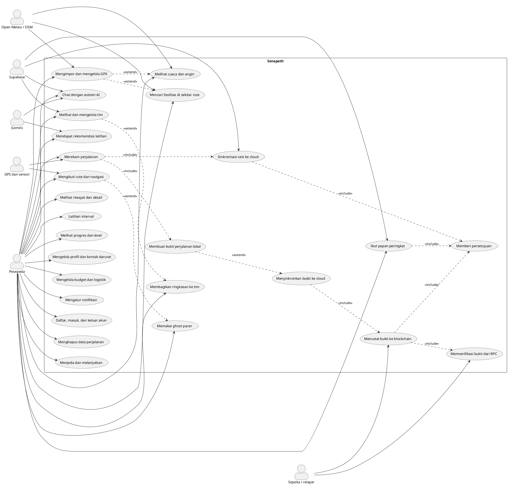
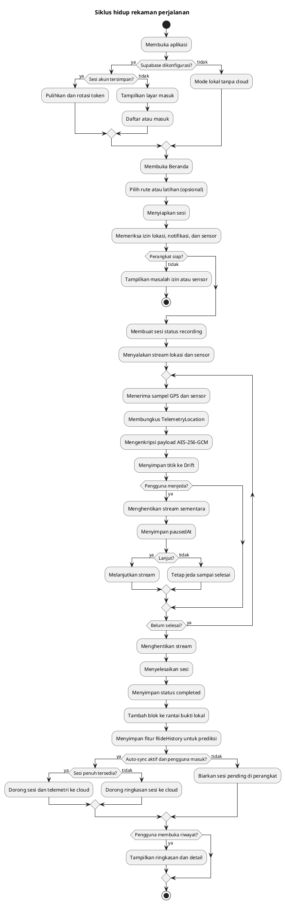
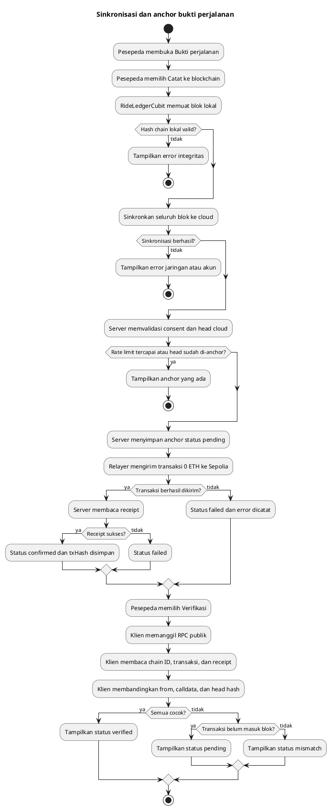
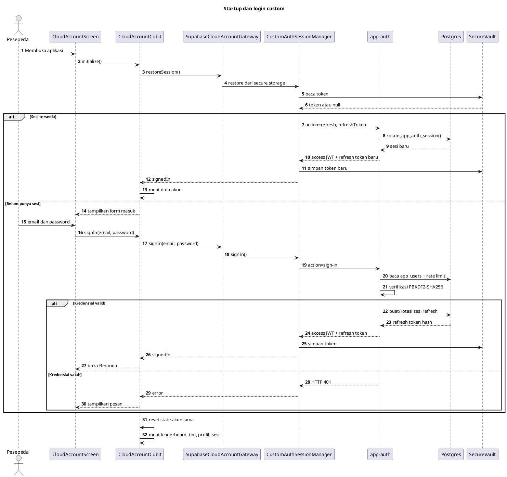
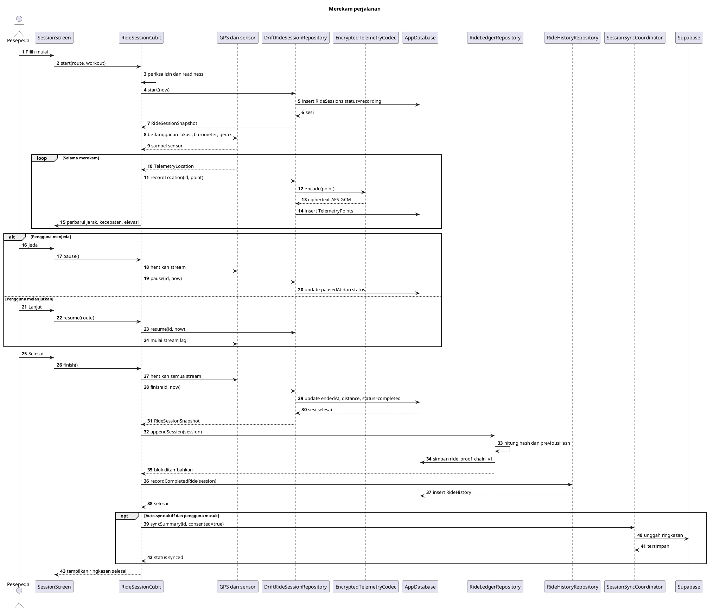
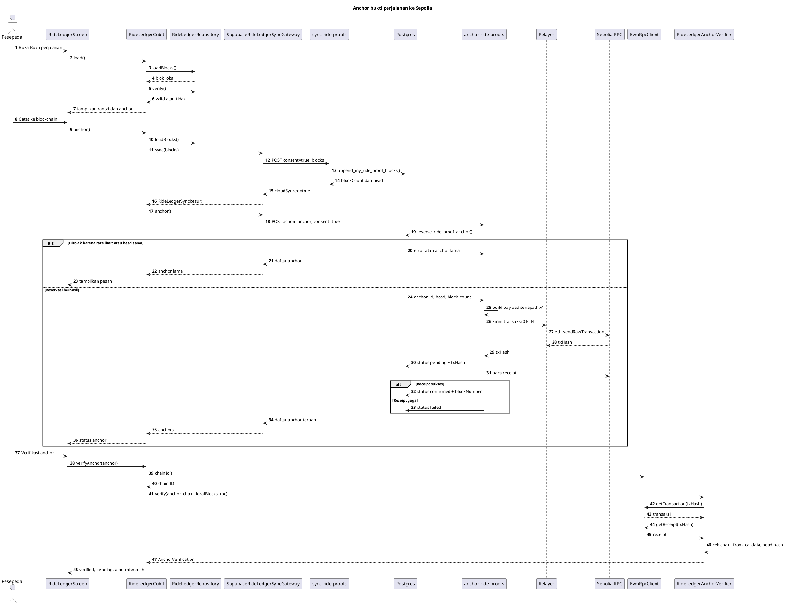
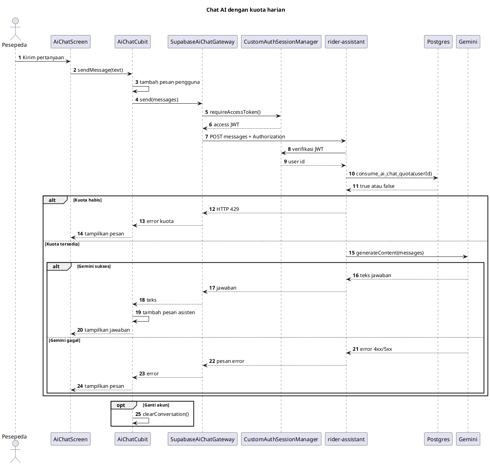
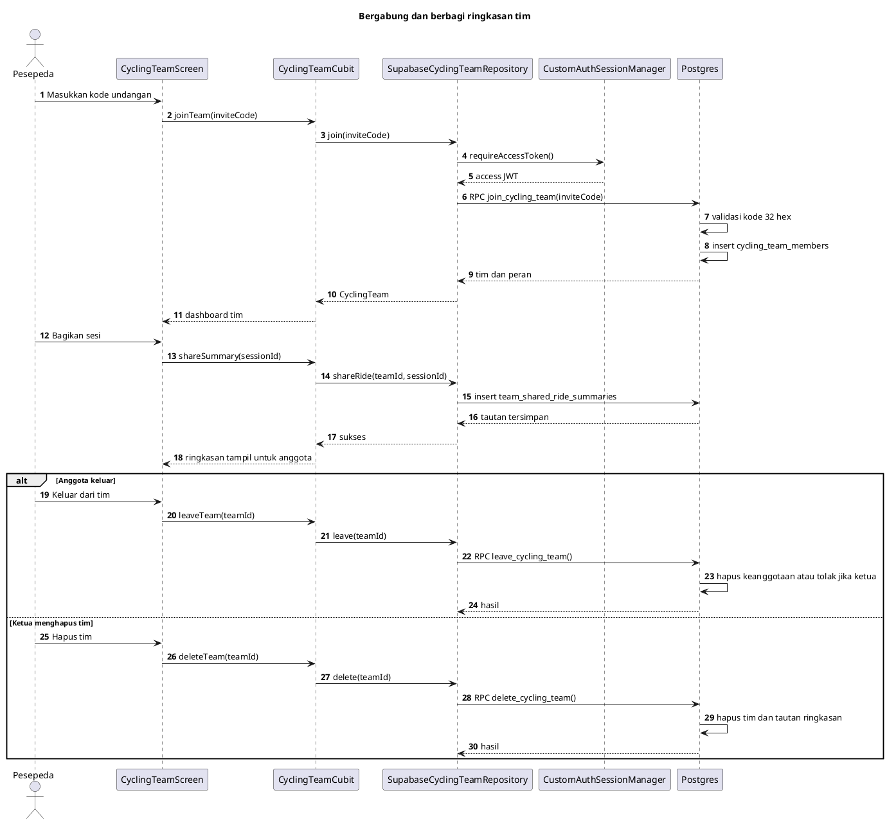

# Senapath - Diagram UML (PlantUML)

Dokumen ini berisi diagram PlantUML untuk memahami perilaku dan struktur kode
Senapath. Setiap blok `plantuml` dapat ditempel ke PlantUML editor, ekstensi
PlantUML di VS Code/JetBrains, atau PlantUML Server. Diagram sengaja tidak
menyertakan seluruh kelas UI agar fokus pada domain, data, dan alur penting.

Dokumentasi naratif ada di [CODEBASE.md](CODEBASE.md).

Daftar diagram:

1. Use case - aktor dan fitur utama
2. Activity - siklus hidup perjalanan
3. Activity - sinkronisasi dan anchor bukti perjalanan
4. Class - domain, repository, gateway, dan Cubit inti
5. Sequence - startup dan autentikasi
6. Sequence - merekam dan menyelesaikan perjalanan
7. Sequence - sinkronisasi dan anchor blockchain
8. Sequence - chat AI dan kuota
9. Sequence - bergabung dengan tim

---

## 1. Use case

---

## 2. Activity - siklus hidup perjalanan

---

## 3. Activity - sinkronisasi dan anchor bukti

---

## 4. Class - inti domain, data, dan presentasi

```plantuml
@startuml
title Kelas inti Senapath
skinparam classAttributeIconSize 0
hide circle

package "core/storage" {
  class AppDatabase {
    +schemaVersion: int
    +appPreferences
    +rideSessions
    +telemetryPoints
    +savedRoutes
    +rideHistory
  }

  interface SecureVault {
    +read(key): String?
    +write(key, value)
    +delete(key)
  }
}

package "features/session" {
  class RideSessionSnapshot {
    +id: String
    +title: String
    +activityType: ActivityType
    +source: String
    +startedAt: DateTime
    +endedAt: DateTime?
    +status: RideSessionStatus
    +syncStatus: String
    +distanceMeters: double
    +gpsAccuracyMeters: double?
    +durationAt(DateTime): Duration
  }

  class TelemetryLocation {
    +recordedAt: DateTime
    +latitude: double
    +longitude: double
    +accuracyMeters: double
    +altitudeMeters: double
    +speedMetersPerSecond: double
  }

  class EncryptedTelemetryCodec {
    +encode(TelemetryLocation): Uint8List
    +decode(Uint8List): TelemetryLocation
    +encryptBytes(List<int>): Uint8List
    +decryptBytes(Uint8List): Uint8List
  }

  interface RideSessionRepository {
    +start(DateTime): RideSessionSnapshot
    +pause(id, DateTime): RideSessionSnapshot
    +resume(id, DateTime): RideSessionSnapshot
    +finish(id, DateTime): RideSessionSnapshot
    +recordLocation(id, TelemetryLocation)
    +loadCompletedSessions()
    +loadSummary(id)
  }

  class DriftRideSessionRepository {
    -database: AppDatabase
    -telemetryCodec: EncryptedTelemetryCodec
  }

  class RideSessionCubit {
    +start(route, workout)
    +pause()
    +resume(route)
    +finish()
    +syncSummary(id, consent)
    +syncCloudSessions()
  }

  class SessionSyncCoordinator {
    +syncSummary(id, consented, teamId)
  }

  interface SessionSyncGateway {
    +isConfigured: bool
    +isSignedIn: bool
    +uploadSummary(summary, teamId)
  }

  class SupabaseSessionSyncGateway

  class RideSessionCloudSync {
    +pullSessions()
    +pushSession(id)
    +deleteSession(id)
  }

  interface AccountCloudGateway {
    +isConfigured: bool
    +isSignedIn: bool
    +pullSetting(key)
    +pushSetting(key, value)
    +pushRideSession(session, points)
    +pullRideSessions()
    +deleteRideSession(id)
  }

  class SupabaseAccountCloudGateway
}

package "features/ledger" {
  class RideLedgerBlock {
    +index: int
    +sessionId: String
    +createdAt: DateTime
    +distanceMeters: double
    +durationSeconds: int
    +previousHash: String
    +hash: String
  }

  class RideLedgerAnchor {
    +id: String
    +blockCount: int
    +headHash: String
    +txHash: String?
    +status: String
    +blockNumber: int?
    +createdAt: DateTime
    +expectedPayload: String
  }

  class RideLedgerChainInfo {
    +chainId: int
    +name: String
    +explorerUrl: String
    +publicRpcUrl: String
    +relayerAddress: String
  }

  class AnchorVerification {
    +status: AnchorVerificationStatus
    +detail: String
  }

  class RideLedgerRepository {
    -database: AppDatabase
    +loadBlocks()
    +appendSession(RideSessionSnapshot)
    +verify(): bool
  }

  interface RideLedgerSyncGateway {
    +isConfigured: bool
    +isSignedIn: bool
    +sync(blocks)
    +anchor()
    +anchors()
  }

  class SupabaseRideLedgerSyncGateway

  class RideLedgerCubit {
    +load()
    +refreshAnchors()
    +verify()
    +sync()
    +anchor()
    +verifyAnchor(RideLedgerAnchor)
  }

  class EvmRpcClient {
    +chainId(): int
    +getTransaction(hash)
    +getReceipt(hash)
  }

  class RideLedgerAnchorVerifier {
    +verify(anchor, chain, localBlocks, rpc)
  }
}

package "features/authentication" {
  class CustomAuthSessionManager {
    +currentUserId: String?
    +requireAccessToken()
    +invokeAuthenticatedFunction(name, body)
    +signIn(email, password)
    +signOut()
  }

  class CloudAccountCubit {
    +initialize()
    +signIn(email, password)
    +signUp(email, password)
    +signOut()
  }

  interface CloudAccountGateway {
    +isConfigured: bool
    +isSignedIn: bool
    +signIn(email, password)
    +signUp(email, password)
    +signOut()
  }

  class SupabaseCloudAccountGateway
}

package "fitur cloud lain" {
  class AiChatCubit
  class SupabaseAiChatGateway
  class CyclingTeamCubit
  class SupabaseCyclingTeamRepository
  class LeaderboardCubit
  class SupabaseLeaderboardGateway
}

RideSessionCubit --> RideSessionRepository
RideSessionCubit --> RideLedgerRepository
RideSessionCubit --> SessionSyncCoordinator
RideSessionCubit --> RideSessionCloudSync
DriftRideSessionRepository ..|> RideSessionRepository
DriftRideSessionRepository --> AppDatabase
DriftRideSessionRepository --> EncryptedTelemetryCodec
EncryptedTelemetryCodec --> SecureVault
SessionSyncCoordinator --> RideSessionRepository
SessionSyncCoordinator --> SessionSyncGateway
SupabaseSessionSyncGateway ..|> SessionSyncGateway
SupabaseSessionSyncGateway --> CustomAuthSessionManager
RideSessionCloudSync --> RideSessionRepository
RideSessionCloudSync --> AccountCloudGateway
SupabaseAccountCloudGateway ..|> AccountCloudGateway
SupabaseAccountCloudGateway --> CustomAuthSessionManager

RideLedgerRepository --> AppDatabase
RideLedgerCubit --> RideLedgerRepository
RideLedgerCubit --> RideLedgerSyncGateway
RideLedgerCubit --> RideLedgerAnchorVerifier
RideLedgerCubit ..> EvmRpcClient : membuat saat verifikasi
RideLedgerAnchorVerifier --> EvmRpcClient
RideLedgerAnchorVerifier ..> RideLedgerBlock
RideLedgerAnchorVerifier ..> RideLedgerAnchor
SupabaseRideLedgerSyncGateway ..|> RideLedgerSyncGateway
SupabaseRideLedgerSyncGateway --> CustomAuthSessionManager

CloudAccountCubit --> CloudAccountGateway
SupabaseCloudAccountGateway ..|> CloudAccountGateway
SupabaseCloudAccountGateway --> CustomAuthSessionManager
CustomAuthSessionManager --> SecureVault

AiChatCubit --> SupabaseAiChatGateway
CyclingTeamCubit --> SupabaseCyclingTeamRepository
LeaderboardCubit --> SupabaseLeaderboardGateway
SupabaseAiChatGateway --> CustomAuthSessionManager
SupabaseCyclingTeamRepository --> CustomAuthSessionManager
SupabaseLeaderboardGateway --> CustomAuthSessionManager

note bottom of RideLedgerRepository
  Hash chain disimpan di AppPreferences
  dengan key ride_proof_chain_v1.
end note

note bottom of CustomAuthSessionManager
  Menyimpan token di SecureVault dan
  memverifikasi JWT lewat Edge Function.
end note
@enduml
```

---

## 5. Sequence - startup dan autentikasi

---

## 6. Sequence - merekam dan menyelesaikan perjalanan

---

## 7. Sequence - sinkronisasi dan anchor blockchain

---

## 8. Sequence - chat AI dan kuota

Catatan: kuota diperiksa sebelum panggilan Gemini. Jika Gemini gagal setelah
kuota terpakai, perilaku pengembalian kuota ditentukan oleh implementasi
`consume_ai_chat_quota`; lihat migrasi `20261001000000_ai_chat_quota.sql`.

---

## 9. Sequence - bergabung dengan tim

---

## Cara merender

- VS Code: pasang ekstensi `PlantUML` (jebbs), buka preview pada blok diagram.
- JetBrains: pasang plugin PlantUML.
- CLI: ekstrak satu blok ke file `.puml`, lalu jalankan
  `java -jar plantuml.jar diagram.puml`.
- Online: tempel isi blok `@startuml ... @enduml` ke PlantUML Server.

Jika diagram diubah, jaga agar nama kelas dan method tetap sesuai dengan kode di
`lib/`. Diagram ini adalah dokumentasi arsitektur, bukan pengganti test.
